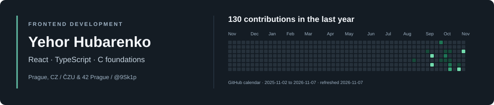

I'm **Yehor**, a frontend-focused Informatika student at **ČZU** and a programming student at **42 Prague**. I build web interfaces and enjoy understanding the systems behind them.

I'm looking for a **frontend internship or junior developer opportunity in Prague**.

 

### Technologies used in my projects

- **Web:** HTML, CSS, JavaScript, TypeScript, React, Tailwind CSS, Vite, Leaflet.
- **Foundations and other projects:** C, Git and REST APIs.

### Selected work

| Project | What I contributed |
| --- | --- |
| [Fares](https://github.com/9Sk1p/fares_web) · [Live website](https://www.autofares.cz/) | Responsive Czech/Russian React website, navigation, gallery and dialogs. |
| [AgroLend](https://github.com/qqxzew/agrolend-) | Frontend workflows, map-based parcel selection, workspace assistant and consent-based clustering in a team project. |
| [Push_swap](https://github.com/9Sk1p/Push_swap) | Developed most of the implementation across sorting strategies, stack operations, parsing, validation and memory handling in a collaborative C project. |
| [AML Triage Copilot](https://github.com/notOlovo/AML) | Streamlit client-review interfaces, tables and visual styling in a team prototype. |

### More C projects from 42 Prague

- [ft_printf](https://github.com/9Sk1p/ft_printf) - variadic formatted output for characters, strings, integers, hexadecimal values and pointers.
- [get_next_line](https://github.com/9Sk1p/get_next_line) - buffered, line-by-line reading from file descriptors with persistent state and dynamic memory.
- [Libft](https://github.com/9Sk1p/Libft_20_08_2026) - utilities for strings, memory and linked lists.

### Education and hackathons

- **ČZU, Informatika:** October 2024 - expected May 2027.
- **42 Prague:** July 2026 - expected November 2027; completed the first milestone.
- **TUM Blockchain & AI Hackathon 2026, Munich:** AgroLend team project.
- **Fintechers Hackathon, Prague:** AML Triage Copilot team project.

[LinkedIn](https://www.linkedin.com/in/yehor-hubarenko-70bb323b4/)

The header uses GitHub’s contribution calendar and refreshes daily. GitHub decides which activity counts; it is not a count of all pushes or uploaded files.
